<div align="center">



<a href="https://ander.icu">
  
</a>

</div>

<br>

<p align="center">
  
</p>

<br>

```zsh
ander@MacBook-Pro ~ % ls stack/
```

<p align="center">
  &nbsp;&nbsp;
  &nbsp;&nbsp;
  &nbsp;&nbsp;
  &nbsp;&nbsp;
  &nbsp;&nbsp;
  &nbsp;&nbsp;
  &nbsp;&nbsp;
  &nbsp;&nbsp;
  &nbsp;&nbsp;
  &nbsp;&nbsp;
  &nbsp;&nbsp;
  &nbsp;&nbsp;
  &nbsp;&nbsp;
  
</p>

```zsh
ander@MacBook-Pro ~ % cat stack.txt
frontend   React · Next.js · TypeScript · JavaScript · Tailwind CSS · Three.js
backend    Node.js · Express · Java
data       MongoDB · MySQL
tools      Git · GitHub · Postman · Figma · OAuth 2.0 · JWT
```

<br>

```zsh
ander@MacBook-Pro ~ % git log --oneline --education
2025 ago → presente   Ing. en Desarrollo de Software ········ UTEZ
2023 sep → 2025 ago   TSU en Tecnologías de la Información ·· UTEZ
2023 feb → 2023 jun   Dip. en Automatización y Mecatrónica ·· UAEM

ander@MacBook-Pro ~ % ls certs/
MongoDB-Nodejs-Developer-Path        nov 2025
Introduction-to-MongoDB              feb 2025
CCNA-Switching-Routing-Wireless      may 2024
CCNA-Introduction-to-Networks        dic 2023
IT-Essentials-Cisco                  dic 2023
```

<br>

```zsh
ander@MacBook-Pro ~ % open links/
```

<p align="center">
  <a href="https://ander.icu"></a>
  <a href="https://github.com/Ander-tsx"></a>
  <a href="https://www.linkedin.com/in/ander-tsx"></a>
  <a href="https://x.com/Ander_tsx"></a>
  <a href="mailto:andres.one.dev@gmail.com"></a>
  <a href="https://ander.icu/files/curriculum.pdf"></a>
</p>

<p align="center">
  
</p>
