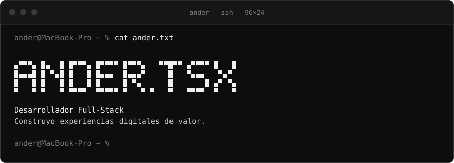
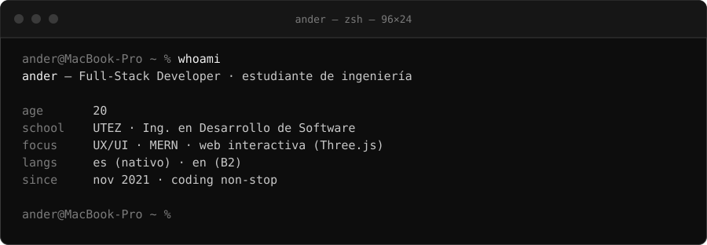
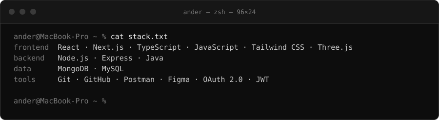
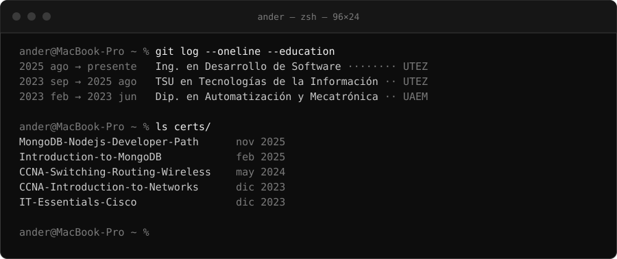
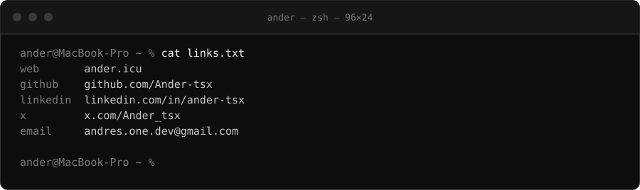

  <a href="https://ander.icu">web</a> ·
  <a href="https://github.com/Ander-tsx">github</a> ·
  <a href="https://www.linkedin.com/in/ander-tsx">linkedin</a> ·
  <a href="https://x.com/Ander_tsx">x</a> ·
  <a href="mailto:andres.one.dev@gmail.com">email</a> ·
  <a href="https://ander.icu/files/curriculum.pdf">cv.pdf</a>

